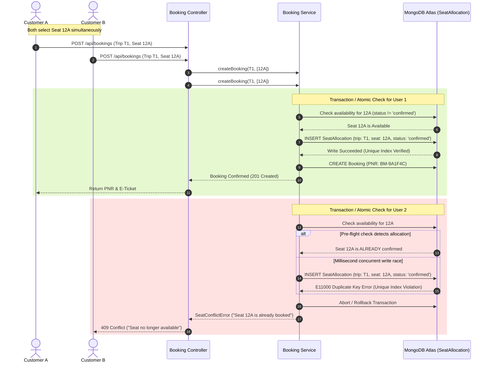
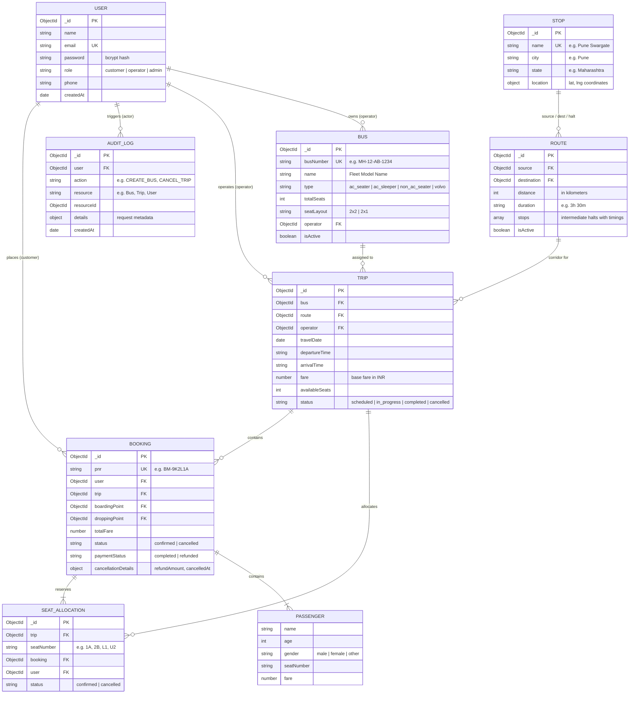
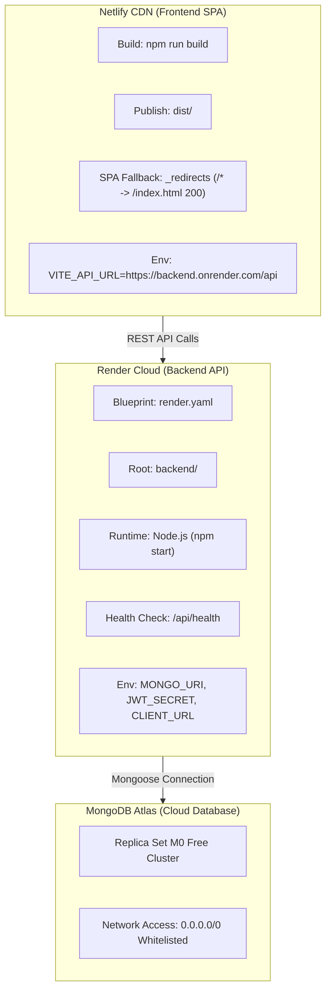

# 🚌 BusMitra — Enterprise Bus Booking Management System

> **A production-grade, full-stack bus reservation, fleet management, and transit dispatch platform built with high-concurrency seat reservation integrity, dynamic pricing, role-based access control, and complete cloud deployment.**  
> *Developed as an individual technical assessment project for **Algions AI Labs Private Limited**.*

---

[](https://nodejs.org/)
[](https://expressjs.com/)
[](https://react.dev/)
[](https://vitejs.dev/)
[](https://www.mongodb.com/atlas)
[](https://tailwindcss.com/)
[](https://jestjs.io/)
[](https://swagger.io/)
[](https://www.netlify.com/)
[](https://render.com/)

---

## 📑 Table of Contents

1. [Executive Overview](#-executive-overview)
2. [Key Highlights & Capabilities](#-key-highlights--capabilities)
3. [System Architecture & Design Patterns](#-system-architecture--design-patterns)
4. [Role-Based Portals & Detailed Feature Matrix](#-role-based-portals--detailed-feature-matrix)
   - [Customer Experience Portal](#1-customer-experience-portal)
   - [Bus Operator Dispatch & Fleet Workspace](#2-bus-operator-dispatch--fleet-workspace)
   - [System Administrator Governance Suite](#3-system-administrator-governance-suite)
5. [The Core Technical Challenge: Concurrency & Seat Integrity](#-the-core-technical-challenge-concurrency--seat-integrity)
6. [Configurable Cancellation & Automated Refund Engine](#-configurable-cancellation--automated-refund-engine)
7. [Geographic Distance Engine & Dynamic Fare Calculation](#-geographic-distance-engine--dynamic-fare-calculation)
8. [Multi-Language Localization (i18n)](#-multi-language-localization-i18n)
9. [Database Architecture & Entity-Relationship Model](#-database-architecture--entity-relationship-model)
10. [RESTful API Specification & Endpoints](#-restful-api-specification--endpoints)
11. [Technology Stack Inventory](#-technology-stack-inventory)
12. [Project Directory Structure](#-project-directory-structure)
13. [Local Development & Setup Guide](#-local-development--setup-guide)
14. [Automated Testing Suite & Verification](#-automated-testing-suite--verification)
15. [Production Cloud Deployment (Render + Netlify)](#-production-cloud-deployment-render--netlify)
16. [Security, RBAC & Compliance](#-security-rbac--compliance)
17. [Key Documents & Reference Links](#-key-documents--reference-links)

---

## 🌟 Executive Overview

**BusMitra** is a full-featured, Indian-transit-tailored intercity bus reservation and fleet operations system. Built to solve real-world transport logistics challenges, it bridges the gap between **passengers** searching and booking travel across major Indian corridors, **bus fleet operators** scheduling vehicles and auditing passenger manifests, and **central transit administrators** overseeing fleet health, revenue analytics, transit corridors, and platform security.

### Core Distinctions:
- **Zero Duplicate Bookings**: Guaranteed race-condition prevention using compound partial unique database constraints coupled with ACID transaction sessions.
- **Real-Time Interactive Decks**: Visual seating maps supporting multiple bus layouts (2×2 luxury pushback, 2×1 multi-axle sleeper lower/upper berths) with live seat status tracking.
- **Indian Transit First**: Real Indian bus corridors (Mumbai, Pune, Bangalore, Delhi, Jaipur, Hyderabad, Goa, Chennai, Ahmedabad), ₹ INR currency standardization, and 4 regional Indian languages.
- **Enterprise Modularity**: Strict clean-architecture modular monolith where business rules are encapsulated in dedicated service layers, keeping controllers thin and maintainable.
- **Instant Deployment Readiness**: Pre-configured for zero-configuration cloud hosting on **Render** (Node.js API) and **Netlify** (React SPA).

---

## ⚡ Key Highlights & Capabilities

| Capability | Implementation Detail |
| :--- | :--- |
| **Concurrency Safeguard** | MongoDB partial unique index on `{ trip: 1, seatNumber: 1 }` with `status: 'confirmed'`, backed by a dual-mode transaction engine (replica set ACID sessions + standalone atomic rollback). |
| **Customer Journey** | End-to-end booking in under 60 seconds: Search → Filter → Seat Layout Selection → Passenger Entry → Simulated Payment → QR Boarding Pass. |
| **Fleet Management** | Bus operators can register new buses, assign seat configurations (2×2, 2×1 sleeper), and schedule new trips on customer routes. |
| **Passenger Manifests** | Instant printable and exportable passenger boarding rosters with seat number, passenger age, gender, contact details, and boarding/dropping points. |
| **Cancellation Rules** | Automatic tiered refund calculation based on departure proximity (>24h = 80%, 12-24h = 50%, <12h = 0%), with immediate seat release for rebooking. |
| **Live Route Tracking** | Visual route tracker modal simulating real-time GPS progress along route checkpoints. |
| **Localized Experience** | Real-time multilingual switching across **English, Hindi (हिंदी), Marathi (मराठी), and Kannada (ಕನ್ನಡ)** with persistent state. |
| **Audit Governance** | Server-side immutable `AuditLog` capturing every administrative and operator action with timestamps, resource IDs, and user roles. |

---

## 🏗️ System Architecture & Design Patterns

The project follows a **Production-Grade Modular Monolith** architecture with strict separation of concerns:

```
┌────────────────────────────────────────────────────────────────────────┐
│                      FRONTEND LAYER (React 18 + Vite)                 │
│  - Public Routes: Search, Trips, Seat Selection, Ticket, Auth         │
│  - Operator Workspace: Fleet Buses, Schedule Trips, Manifests         │
│  - Admin Suite: Analytics, Fleet, Routes, Stops, Users, Audit Logs     │
│  - State & Context: AuthContext, LanguageContext, Axios Interceptors   │
└───────────────────────────────────┬────────────────────────────────────┘
                                    │ HTTPS / REST JSON
                                    ▼
┌────────────────────────────────────────────────────────────────────────┐
│                      API & MIDDLEWARE GATEWAY (Express)                │
│  - Production CORS (Netlify Wildcard + Configured Domains)             │
│  - JWT Bearer Authentication (7-day signed tokens)                     │
│  - Server-Side RBAC: Customer / Operator / Admin Enforcement          │
│  - Request Validation: express-validator schemas                       │
│  - Centralized Error Handling & Uniform JSON Formatter                 │
└───────────────────────────────────┬────────────────────────────────────┘
                                    │
                                    ▼
┌────────────────────────────────────────────────────────────────────────┐
│                      BUSINESS LOGIC SERVICES LAYER                     │
│  - booking.service.js      - trip.service.js      - bus.service.js    │
│  - cancellation.service.js - auth.service.js      - distance.js       │
│  - auditLogger.middleware  - dynamicPricing.js    - pnr.js            │
└───────────────────────────────────┬────────────────────────────────────┘
                                    │
                                    ▼
┌────────────────────────────────────────────────────────────────────────┐
│                      DATA PERSISTENCE LAYER (MongoDB Mongoose)         │
│  - Users          - Buses         - Stops          - Routes            │
│  - Trips          - Bookings      - SeatAllocations - AuditLogs        │
│  - ACID Transactions (Replica Set / Atlas)                            │
│  - Compound Partial Unique Indexes for Conflict Prevention             │
└────────────────────────────────────────────────────────────────────────┘
```

### Key Architectural Tenets:
1. **Thin Controllers, Rich Services**: Controllers only validate HTTP inputs and return standardized responses; all operational decisions, pricing mathematics, database sessions, and status updates live in `src/services/`.
2. **Dual-Mode Transaction Engine**: Enables local development on standalone MongoDB without requiring a local replica set, while automatically utilizing replica-set transactions when deployed to MongoDB Atlas.
3. **Stateless JWT Security**: Passwords hashed using `bcrypt` (12 salt rounds); authenticated sessions use cryptographically signed JWT bearer tokens stored securely and validated on every protected endpoint.

---

## 👥 Role-Based Portals & Detailed Feature Matrix

### 1. Customer Experience Portal

The customer portal provides an intuitive, high-speed travel booking experience designed specifically for intercity travelers.

```
Homepage Search Form
        │
        ▼
Search Results Page (Filters: Bus Type, AC/Non-AC, Operators, Departure Time, Price Slider)
        │
        ▼
Trip Detail Page (Route path, boarding & dropping points, amenities)
        │
        ▼
Interactive Seat Selection (Visual deck, 2x2 / 2x1 sleeper, dynamic pricing)
        │
        ▼
Passenger Details Entry (Name, Age, Gender, Primary Contact, GST Invoice)
        │
        ▼
Booking Confirmation & Checkout (Fare summary, discounts, simulated payment)
        │
        ▼
Digital E-Ticket Issuance (Unique PNR, QR Code, Print & PDF download)
        │
        ▼
My Bookings Dashboard (Active / Past trips, 1-click cancellation with live refund preview)
```

#### Detailed Customer Features:
- **Hero Journey Search**: City auto-complete across major Indian transit hubs, single-click origin/destination swap, dynamic date picker with minimum-date safeguards, and passenger counter.
- **Faceted Search Results**:
  - Filter by operator, bus category (AC Sleeper, Non-AC Seater, Volvo Multi-Axle, BharatBenz).
  - Filter by departure time windows (Morning 06:00-12:00, Afternoon 12:00-18:00, Evening 18:00-24:00, Night 00:00-06:00).
  - Dynamic price range slider and instant sorting (Cheapest, Earliest, Fastest).
  - Live seat availability indicators with "Filling Fast" alerts for trips with <5 available seats.
- **Interactive Seat Deck Selection**:
  - Visual color-coded seat deck: Available (Green/White), Selected (Electric Lime), Booked (Gray/Disabled).
  - Multi-tier layouts: Seater decks (2×2 layout with driver cabin orientation) and Sleeper decks (2×1 layout with Lower and Upper berths).
  - Real-time cart calculation updating base fare, taxes, and total payable amounts as seats are clicked.
- **Passenger Details & Contact**: Captures full passenger roster (name, age, gender) per assigned seat, validates Indian mobile numbers (`+91`), and stores primary contact email for ticket delivery.
- **Checkout & Instant Payment Simulation**: Complete fare breakdown showing base ticket fare, dynamic convenience fees, and 5% GST; simulated payment processing with immediate confirmation.
- **Digital E-Ticket & Boarding Pass**:
  - Automatically issues a unique, tamper-proof PNR code (e.g. `BM-TR8K2L`).
  - Generates a scannable QR Code encoding PNR, passenger roster, and departure metadata.
  - Printable boarding pass view and instant browser PDF export.
- **Self-Service My Bookings & Cancellation**:
  - View all active, completed, and cancelled reservations.
  - Live cancellation modal displaying the applicable refund slab, deduction percentage, and net refundable amount in ₹ INR.
  - Immediate seat release: seats become instantly available for other travelers the moment a cancellation is confirmed.
- **Interactive Utility Modals**:
  - **Live Bus Tracker**: Real-time checkpoint tracker simulating GPS journey progress.
  - **Explore Route Network**: High-level map and connectivity guide across Indian states.
  - **Mobile App Download Modal**: Android & iOS app discovery dialog.
  - **Manage Booking Modal**: Direct navbar shortcut allowing guest users to look up and manage tickets using PNR and email without logging in.

---

### 2. Bus Operator Dispatch & Fleet Workspace

Operators have a dedicated operations hub (`/operator/*`) to manage their assigned fleet, routes, and passenger logistics.

- **Operator Dashboard (`/operator/dashboard`)**:
  - High-level KPI widgets: Total fleet size, active scheduled trips, overall fleet occupancy percentage, and total passengers carried.
  - Upcoming trip departures schedule for the next 24–48 hours.
- **Fleet Bus Management (`/operator/buses`)**:
  - View all registered buses owned by or assigned to the operator.
  - **Add New Bus Modal**: Register new buses by specifying vehicle registration number (e.g., `MH-12-AB-1234`), custom fleet name, bus type (AC Sleeper, Non-AC Seater, Volvo), seat layout type (`2x2` or `2x1`), and total seat capacity.
  - Real-time bus specifications review and status indicators.
- **Schedule New Trip (`/operator/schedule`)**:
  - Dispatch a bus onto any active customer route corridor.
  - Select travel date, departure time, estimated arrival time, and customize the base ticket fare.
  - Automated seat allocation generation: The system automatically provisions the corresponding seat inventory according to the bus layout.
- **Assigned Trips & Occupancy Monitor (`/operator/trips`)**:
  - Live status tracking of every scheduled departure (`scheduled`, `in-transit`, `completed`, `cancelled`).
  - Visual seat occupancy progress bar showing confirmed seats vs total capacity.
  - Revenue tracking per trip in ₹ INR.
- **Passenger Boarding Manifest (`/operator/manifest/:tripId`)**:
  - Real-time, printable passenger manifest roster for transit staff and drivers at boarding gates.
  - Details per passenger: Seat number, full name, age, gender, boarding stop, dropping stop, contact phone number, and check-in status.

---

### 3. System Administrator Governance Suite

The administrative portal (`/admin/*`) provides central governance over the entire transit platform.

- **Executive Analytics Dashboard (`/admin/dashboard`)**:
  - Real-time platform KPI cards: Gross Platform Revenue (₹), Total Bookings, Active Fleet Count, Total Registered Users, and System Occupancy Rate.
  - Visual charts showing revenue trends and route popularity.
  - Recent booking transaction stream.
- **Fleet Management (`/admin/buses`)**:
  - Central registry of all buses across all operators.
  - Add, edit, or decommission buses; assign operator owners.
- **Transit Hub & Stop Management (`/admin/stops`)**:
  - Manage all boarding stations, drop points, and transit terminals.
  - Metadata includes station name, city, state, and geographic pin.
- **Route Corridor Management (`/admin/routes`)**:
  - Connect origin and destination stops into structured travel corridors.
  - Configure intermediate boarding and dropping halts with scheduled arrival offsets.
  - Store corridor distance (km) and estimated travel duration.
- **Trip Dispatch Management (`/admin/trips`)**:
  - Master schedule overview: create, reschedule, cancel, or modify trips.
  - Price override capabilities and trip status toggles.
- **Master Booking Management (`/admin/bookings`)**:
  - Search and inspect every booking across the system by PNR, customer, or travel date.
  - Review passenger manifests, payment status (`completed`, `refunded`), and cancellation audits.
- **User & Access Management (`/admin/users`)**:
  - View all registered platform users (customers, operators, administrators).
  - Dynamic role promotion and demotion: promote customers to operators or grant administrative privileges.
- **Security Audit Logs (`/admin/audit-logs`)**:
  - Immutable activity log capturing every sensitive administrative action.
  - Records: Timestamp, actor (User ID and role), action type (`CREATE_BUS`, `CANCEL_TRIP`, `UPDATE_ROLE`, etc.), affected resource, and metadata.

---

## 🔒 The Core Technical Challenge: Concurrency & Seat Integrity

In online bus booking platforms, **the race condition** occurs when two or more users attempt to book the exact same seat on the same bus trip at the exact same millisecond.

### The Two-Tiered Solution in BusMitra:



### 1. Database-Level Partial Unique Index
Rather than relying solely on application-level locks, BusMitra enforces constraint integrity at the database storage engine level:
```javascript
// backend/src/models/seatAllocation.model.js
seatAllocationSchema.index(
  { trip: 1, seatNumber: 1 },
  { unique: true, partialFilterExpression: { status: 'confirmed' } }
);
```
**Why this design is superior:**
- **Zero False-Positives**: Two confirmed bookings for the same seat on the same trip are rejected by the database with error code `11000`.
- **Cancelled Seats Automatically Re-Enter Inventory**: When a customer cancels, the record status updates to `'cancelled'`. Because the unique constraint is *partial* (`status: 'confirmed'`), the seat is instantly available for rebooking without deleting historical audit records.

### 2. Dual-Mode Transaction Support
- **Atlas / Replica Set Mode**: Uses native MongoDB multi-document ACID transactions (`session.startTransaction()`) to guarantee that booking record creation, seat allocation, trip available seat decrements, and payment logging commit together or roll back completely.
- **Standalone Mode**: Employs an atomic pre-reservation pipeline with automatic programmatic compensating rollbacks if any subsequent step encounters an error.

---

## 💰 Configurable Cancellation & Automated Refund Engine

BusMitra implements an industry-standard, time-bracketed cancellation policy executed server-side:

```
                          Cancellation Request Received
                                       │
                    Calculate Hours Remaining to Departure
                                       │
             ┌─────────────────────────┼─────────────────────────┐
             ▼                         ▼                         ▼
      > 24 Hours Prior          12 – 24 Hours Prior        < 12 Hours Prior
             │                         │                         │
        80% Refund                50% Refund                 0% Refund
      (20% Cancellation Fee)    (50% Cancellation Fee)    (100% Cancellation Fee)
             │                         │                         │
             └─────────────────────────┼─────────────────────────┘
                                       │
                      Update Booking Status to CANCELLED
                                       │
                 Update SeatAllocations to CANCELLED (Releases Seats)
                                       │
                     Increment Trip Available Seats Counter
                                       │
                 Log Simulated Refund Transaction ID (REF-XXXXX)
```

| Proximity to Scheduled Departure | Refund Percentage | Cancellation Deduction | Resulting Seat State |
| :--- | :--- | :--- | :--- |
| **> 24 hours** before departure | **80%** of total fare | 20% convenience fee | Immediately Available |
| **12 to 24 hours** before departure | **50%** of total fare | 50% cancellation charge | Immediately Available |
| **< 12 hours** before departure | **0%** (Non-refundable) | 100% deduction | Immediately Available |

---

## 📍 Geographic Distance Engine & Dynamic Fare Calculation

BusMitra calculates real-world Indian intercity travel metrics using the **Haversine Great-Circle Distance Equation**:

$$\Delta\sigma = 2 \arcsin \left( \sqrt{\sin^2\left(\frac{\Delta\phi}{2}\right) + \cos(\phi_1)\cos(\phi_2)\sin^2\left(\frac{\Delta\lambda}{2}\right)} \right)$$

$$\text{Distance (km)} = R \times \Delta\sigma \times 1.25 \quad (\text{where } R = 6371\text{ km, and } 1.25 \text{ is the Indian Highway Winding Factor})$$

### Base Fare Formulation:
$$\text{Base Fare} = \max\left(\text{MinFare}, \text{Distance} \times \text{RatePerKm} \times \text{BusTypeMultiplier} \times \text{DemandFactor}\right)$$

| Bus Configuration Category | Bus Multiplier | Typical Amenities |
| :--- | :--- | :--- |
| **Standard Seater (Non-AC)** | `1.0x` | Pushback seats, reading lamps, luggage rack |
| **AC Executive Seater** | `1.3x` | Climate control, USB charging ports, high-speed Wi-Fi |
| **Luxury Sleeper (AC Berth)** | `1.6x` | Individual sleeping berths, privacy curtains, blankets, water bottle |
| **Volvo / Scania Multi-Axle** | `1.8x` | Air suspension, emergency panic buttons, snack hamper, live GPS |

---

## 🌐 Multi-Language Localization (i18n)

To serve India's diverse demographic landscape, BusMitra includes client-side internationalization managed through a centralized React Context (`LanguageContext.jsx`):

| Language | Native Script | Key Localized Modules |
| :--- | :--- | :--- |
| **English** | English | Complete interface, search, booking, admin & operator portals |
| **Hindi** | हिन्दी | Search form, navbar, trip cards, seat legend, booking steps |
| **Marathi** | मराठी | Core booking workflow, bus categories, stop selections |
| **Kannada** | ಕನ್ನಡ | Navigation, seat selection decks, customer action prompts |

The user's language selection is automatically persisted in browser `localStorage` and preserved across page reloads.

---

## 🗄️ Database Architecture & Entity-Relationship Model



---

## 📡 RESTful API Specification & Endpoints

All endpoints follow strict REST conventions, consume and produce `application/json`, and return consistent envelope responses:
```json
{
  "success": true,
  "data": { ... },
  "message": "Operation completed successfully"
}
```

### Authentication (`/api/auth`)
| Method | Endpoint | Access | Description |
| :--- | :--- | :--- | :--- |
| `POST` | `/api/auth/register` | Public | Register new customer account |
| `POST` | `/api/auth/login` | Public | Authenticate user & receive JWT bearer token |
| `GET` | `/api/auth/me` | Authenticated | Retrieve current authenticated user profile |

### Trip Discovery (`/api/trips`)
| Method | Endpoint | Access | Description |
| :--- | :--- | :--- | :--- |
| `GET` | `/api/trips/search` | Public | Search trips by origin, destination, date, and filters |
| `GET` | `/api/trips/:id` | Public | Get full trip details, route path, stops, and pricing |
| `GET` | `/api/trips/:id/seats` | Public | Get live seat map layout and availability status |
| `POST` | `/api/trips` | Operator/Admin | Schedule a new trip on a route |
| `PUT` | `/api/trips/:id` | Operator/Admin | Update departure time, fare, or status |
| `DELETE` | `/api/trips/:id` | Operator/Admin | Cancel or remove a scheduled trip |

### Reservations & Bookings (`/api/bookings`)
| Method | Endpoint | Access | Description |
| :--- | :--- | :--- | :--- |
| `POST` | `/api/bookings` | Customer | Reserve seats and generate confirmed PNR booking |
| `GET` | `/api/bookings` | Authenticated | List all bookings for the logged-in customer |
| `GET` | `/api/bookings/:id` | Authenticated | Get detailed booking receipt, passenger info, and PNR |
| `POST` | `/api/bookings/:id/cancel` | Authenticated | Cancel booking, calculate refund, and release seats |

### Bus Fleet Management (`/api/buses`)
| Method | Endpoint | Access | Description |
| :--- | :--- | :--- | :--- |
| `GET` | `/api/buses` | Authenticated | List all buses (filtered by operator for operators) |
| `GET` | `/api/buses/my` | Operator | Retrieve fleet buses owned by the current operator |
| `POST` | `/api/buses` | Operator/Admin | Register a new bus and define its seat layout |
| `PUT` | `/api/buses/:id` | Operator/Admin | Update bus details, maintenance status, or capacity |
| `DELETE` | `/api/buses/:id` | Admin | Decommission a bus from the registry |

### Operator Dispatch (`/api/operators`)
| Method | Endpoint | Access | Description |
| :--- | :--- | :--- | :--- |
| `GET` | `/api/operators/trips` | Operator | Get scheduled trips and occupancy metrics for operator |
| `GET` | `/api/operators/trips/:id/manifest` | Operator/Admin | Generate live passenger boarding manifest roster |

### Administrative Governance (`/api/admin`)
| Method | Endpoint | Access | Description |
| :--- | :--- | :--- | :--- |
| `GET` | `/api/reports/dashboard` | Admin | Real-time platform revenue and occupancy KPI analytics |
| `GET` | `/api/routes` | Operator/Admin | List and manage intercity travel corridors |
| `POST` | `/api/routes` | Admin | Create a new corridor with intermediate halts |
| `GET` | `/api/stops` | Public | List all bus stations, terminals, and transit points |
| `POST` | `/api/stops` | Admin | Add a new transit terminal or city hub |
| `GET` | `/api/users` | Admin | List all registered platform accounts |
| `PUT` | `/api/users/:id/role` | Admin | Update user privileges (`customer`, `operator`, `admin`) |
| `GET` | `/api/audit-logs` | Admin | Query immutable administrative audit trail logs |

> 📖 **Interactive Swagger UI**: Explore and test every endpoint live at `http://localhost:5000/api/docs`.

---

## 🛠️ Technology Stack Inventory

### Backend Architecture
- **Runtime**: Node.js (v18.x LTS)
- **Framework**: Express.js (`^4.18.2`)
- **Database & ODM**: MongoDB Atlas / Mongoose (`^7.6.3`)
- **Authentication**: JSON Web Token (`jsonwebtoken ^9.0.2`), bcryptjs (`^2.4.3`)
- **Input Validation**: `express-validator (^7.0.1)`
- **API Documentation**: OpenAPI 3.0 / `swagger-ui-express (^5.0.0)`
- **Automated Testing**: Jest (`^29.7.0`), Supertest (`^6.3.3`)
- **Logging & Security**: Morgan (`^1.10.0`), CORS (`^2.8.5`), Dotenv (`^16.3.1`)

### Frontend Architecture
- **Framework**: React 18 (`^18.2.0`)
- **Build Tool**: Vite 5 (`^5.0.0`)
- **Routing**: React Router DOM (`^6.20.0`)
- **Styling**: Tailwind CSS (`^3.3.6`), PostCSS, Autoprefixer
- **Icons**: Lucide React (`^0.294.0`)
- **HTTP Client**: Axios (`^1.6.2`) with global request/response interceptors

---

## 📁 Project Directory Structure

```
Bus-Booking-Management-System/
├── backend/
│   ├── server.js                        # Express server entry point, CORS, health probes
│   ├── package.json                     # Backend scripts & dependency manifest
│   ├── .env.example                     # Environment configuration template
│   └── src/
│       ├── config/
│       │   ├── db.js                    # MongoDB connection with 5x retry loop
│       │   └── swagger.js               # OpenAPI 3.0 specification generator
│       ├── models/                      # 8 Mongoose Schema definitions
│       │   ├── user.model.js
│       │   ├── bus.model.js
│       │   ├── stop.model.js
│       │   ├── route.model.js
│       │   ├── trip.model.js
│       │   ├── booking.model.js
│       │   ├── seatAllocation.model.js  # Partial unique constraint
│       │   └── auditLog.model.js
│       ├── controllers/                 # HTTP Request handling & validation
│       │   ├── auth.controller.js
│       │   ├── trip.controller.js
│       │   ├── booking.controller.js
│       │   ├── bus.controller.js
│       │   ├── route.controller.js
│       │   ├── stop.controller.js
│       │   ├── operator.controller.js
│       │   ├── report.controller.js
│       │   ├── user.controller.js
│       │   └── auditLog.controller.js
│       ├── services/                    # Core business logic & transactions
│       │   ├── auth.service.js
│       │   ├── booking.service.js       # ACID seat allocation & rollback
│       │   ├── cancellation.service.js  # Tiered refund engine
│       │   ├── trip.service.js
│       │   ├── bus.service.js
│       │   └── report.service.js
│       ├── middleware/                  # Security & pipeline middleware
│       │   ├── auth.js                  # JWT token verification
│       │   ├── authorize.js             # RBAC role authorization
│       │   ├── auditLogger.js           # Administrative activity tracking
│       │   └── errorHandler.js          # Centralized error formatter
│       ├── validators/                  # express-validator schemas
│       ├── utils/                       # Distance, PNR, and response helpers
│       ├── seed/                        # Indian routes & demo users seeder
│       └── tests/                       # Jest & Supertest automated test suite
├── frontend/
│   ├── index.html                       # HTML5 entry with mobile meta tags
│   ├── vite.config.js                   # Vite configuration & dev proxy
│   ├── tailwind.config.js               # Electric Lime & Noir design theme
│   ├── netlify.toml                     # Netlify build & redirect rules
│   ├── package.json                     # Frontend scripts & dependencies
│   ├── public/
│   │   └── _redirects                   # Netlify SPA deep-linking rewrite rule
│   └── src/
│       ├── main.jsx                     # React root initialization
│       ├── App.jsx                      # Route definitions & guards
│       ├── index.css                    # Tailwind utility injections & custom scrollbars
│       ├── Assets/                      # High-definition brand assets & hero image
│       ├── context/
│       │   ├── AuthContext.jsx          # JWT state & user credentials
│       │   └── LanguageContext.jsx      # Multi-language localization provider
│       ├── services/
│       │   └── api.js                   # Axios client with dynamic VITE_API_URL
│       ├── layouts/                     # PublicLayout, AdminLayout, OperatorLayout
│       ├── components/                  # Reusable components (Navbar, Footer, Modals)
│       └── pages/                       # 20+ Customer, Operator & Admin screens
├── guide.md                             # Step-by-step production deployment manual
├── TECHNICAL_REPORT.md                  # Comprehensive design report & video script
├── PROJECT_DEVELOPMENT_JOURNEY.md       # Chronological development & task archive
├── render.yaml                          # Render Web Service Blueprint (IaC)
├── netlify.toml                         # Root Netlify build configuration
└── README.md                            # Complete Project Documentation
```

---

## 💻 Local Development & Setup Guide

### 1. Prerequisites
- **Node.js**: `v18.x` or higher installed ([Download](https://nodejs.org/))
- **MongoDB**: Local MongoDB community instance running, or a free **MongoDB Atlas** cluster URI.
- **Git**: Installed for version control.

### 2. Clone the Repository
```bash
git clone https://github.com/ananya411/Bus-Booking-Management-System.git
cd Bus-Booking-Management-System
```

### 3. Backend Setup
```bash
# Navigate to backend directory
cd backend

# Install dependencies
npm install

# Create environment configuration
cp .env.example .env
```

Configure your `.env` file:
```env
PORT=5000
NODE_ENV=development
MONGO_URI=mongodb+srv://<username>:<password>@cluster0.xxxxx.mongodb.net/busmitra?retryWrites=true&w=majority
JWT_SECRET=your_super_secret_development_key_min_32_characters
JWT_EXPIRE=7d
CLIENT_URL=http://localhost:5173
```

Seed the database with Indian corridors, transit stops, buses, trips, and test users:
```bash
npm run seed -- --force
```

Start the backend API server:
```bash
npm run dev
```
- API Server: `http://localhost:5000`
- Interactive Swagger Documentation: `http://localhost:5000/api/docs`
- Health Endpoint: `http://localhost:5000/api/health`

### 4. Frontend Setup
In a new terminal window:
```bash
# Navigate to frontend directory
cd frontend

# Install dependencies
npm install

# Start development server
npm run dev
```
- Frontend Client: `http://localhost:5173`

---

## 🔑 Pre-Seeded Demo Credentials

The database seeder automatically provisions test accounts across all three user roles:

| User Role | Email Address | Password | Permissions & Dashboard |
| :--- | :--- | :--- | :--- |
| **System Admin** | `admin@demo.com` | `Demo@123` | Executive access (`/admin/*`), revenue analytics, fleet oversight, user management, audit logs. |
| **Bus Operator** | `operator@demo.com` | `Demo@123` | Operational workspace (`/operator/*`), bus fleet management, trip scheduling, passenger manifests. |
| **Customer** | `customer@demo.com` | `Demo@123` | Consumer booking portal, search, seat selection, booking history, ticket cancellation. |

---

## 🧪 Automated Testing Suite & Verification

The backend includes an automated test suite executed with **Jest** and **Supertest** covering authentication, search, booking lifecycles, and concurrency conflict rejection:

```bash
cd backend
npm test
```

### Verified Test Cases:
1. `POST /api/auth/register` — Validates customer registration, schema hashing, and unique email rejection.
2. `POST /api/auth/login` — Successfully verifies password and issues signed JWT bearer token.
3. `POST /api/auth/login` (Invalid Credentials) — Rejects wrong password with `401 Unauthorized`.
4. `GET /api/auth/me` (Protected) — Rejects requests lacking bearer token with `401`.
5. `GET /api/trips/search` — Validates trip discovery by origin, destination, and travel date.
6. `POST /api/bookings` (Happy Path) — Successfully reserves seats, generates unique PNR, and creates `SeatAllocation`.
7. `POST /api/bookings` (**Concurrency Conflict**) — **Attempts duplicate seat allocation for an already confirmed seat; asserts immediate `409 Conflict` rejection.**
8. `POST /api/bookings/:id/cancel` — Cancels booking, calculates correct refund percentage, and confirms seat is released for rebooking.
9. `GET /api/admin/reports` (RBAC Guard) — Rejects unauthorized customer access to admin routes with `403 Forbidden`.
10. `GET /api/operators/trips` (Operator Guard) — Verifies role-based isolation of operator resources.

---

## ☁️ Production Cloud Deployment (Render + Netlify)

BusMitra is pre-configured for automated, continuous cloud deployment:



### Configuration Summary:
1. **Backend on Render**:
   - Pre-configured using [render.yaml](render.yaml) blueprint.
   - Root directory set to `backend`.
   - Healthcheck probe set to `/api/health`.
   - CORS automatically configured to allow all `*.netlify.app` origins and the production `CLIENT_URL`.
2. **Frontend on Netlify**:
   - Pre-configured using [netlify.toml](netlify.toml) and [frontend/public/_redirects](frontend/public/_redirects).
   - Base directory set to `frontend`, publish directory set to `dist`.
   - Eliminates 404 errors on page refresh via SPA wildcard rewrites.
3. **Complete Walkthrough**:
   - For step-by-step instructions with screenshots and MongoDB Atlas setup, see **[guide.md](guide.md)**.

---

## 🛡️ Security, RBAC & Compliance

- **Password Cryptography**: All passwords hashed using `bcryptjs` with 12 salt rounds before database persistence.
- **Stateless Authorization**: Signed JSON Web Tokens (7-day duration) verified on every restricted endpoint.
- **Server-Side RBAC Enforcement**: Role privileges (`customer`, `operator`, `admin`) enforced strictly in backend Express middleware, preventing UI-bypass exploits.
- **Input Sanitization**: All incoming query and body parameters validated and sanitized through `express-validator` to neutralize SQL/NoSQL injection and XSS vectors.
- **Tamper-Evident Audit Logging**: Administrative interventions (route additions, trip rescheduling, user role changes) are captured in the immutable `AuditLog` collection.
- **CORS Whitelist Protection**: Cross-Origin requests restricted to authorized frontend origins.

---

## 📚 Key Documents & Reference Links

- **[guide.md](guide.md)** — Comprehensive step-by-step production deployment guide for Render, Netlify, and MongoDB Atlas.
- **[TECHNICAL_REPORT.md](TECHNICAL_REPORT.md)** — Architectural design decisions, concurrency proofs, database justifications, and 3–5 minute video demonstration script.
- **[PROJECT_DEVELOPMENT_JOURNEY.md](PROJECT_DEVELOPMENT_JOURNEY.md)** — Complete chronological log of every task, problem solved, feature built, and milestone reached from scratch to completion.
- **Interactive API Docs**: `http://localhost:5000/api/docs` (when backend is running).

---

## 👥 Assessment Submission Details

- **Candidate**: Ananya Jaiswal
- **Organization**: Algions AI Labs Private Limited
- **Assessment Domain**: Full-Stack Web Development Internship Assessment (Bus Booking Management System)
- **License**: [MIT License](LICENSE)

*Built with passion, architectural precision, and real-world scalability.*
